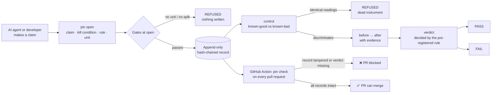

# pinproof

**Make AI agents pre-register what "done" means, with tamper-evident records.**

*Designed and battle-tested by Robert Dove over about 2,800 real verifications. Built with AI-assisted development; every feature was added after a measured failure, and the tool tests itself with negative controls.*

[](https://github.com/DoveWeb/pinproof/actions/workflows/ci.yml)

| From real use (aggregate, private projects) | |
|---|---|
| verification records | **2,791** |
| hash chains intact | **2,791** (0 broken) |
| claims that **failed** their own pre-registered bar | **558** (1 in 5) |
| records that ran a control (known-good vs known-bad) | **2,506** (90%) |

## The problem: reviewing AI-written pull requests
An AI agent says "tests pass", "it's fixed", "the page is live", and a reviewer has to check. The common failure isn't skipping the check. It's **deciding what counts as passing after seeing the result**, or trusting a check that could never have failed.

pinproof makes every claim declare, **before anything is measured**:
1. its **kill condition**: the result that would prove it false
2. a **rule and a unit**: what is counted, and the pass bar
3. a **control**: a known-good and a known-bad case that must read differently

The verdict is then decided by the pre-registered rule. Every record is an append-only, hash-chained event log, so editing the pass bar afterwards is detectable, and the **GitHub Action blocks the pull request**.



## Install
```bash
pipx install git+https://github.com/DoveWeb/pinproof   # gives the `pin` command
# or just download pinproof.py: one file, Python 3.9+, standard library only
```

## Quick start
```bash
pin open fix-login-timeout \
  --claim "the login no longer times out under 50 concurrent users" \
  --kill  "any timeout in a 50-user load run kills the claim" \
  --rule  "after==0" --unit "timeouts in a 50-user load run" \
  --single "one load run, one count" \
  --degenerate "a run that never reaches 50 users also shows 0 timeouts; the log must show 50 sessions"

pin before  fix-login-timeout --value 7 --evidence "run #1 before the fix: 7 timeouts of 50"
pin after   fix-login-timeout --value 0 --evidence "run #2 after the fix: 0 timeouts, 50 sessions in the log"
pin verdict fix-login-timeout
```
```
CLAIM UNDER TEST : the login no longer times out under 50 concurrent users
RULE   : after==0
COUNTING: timeouts in a 50-user load run
EVAL   : after(0) == 0(0) -> PASS
>>> PASS <<<
```
Records live in `~/.claude/pins/` by default. Set `PIN_DIR=.pins` to keep them in your repo.

## The GitHub Action
```yaml
# .github/workflows/pins.yml
on: pull_request
jobs:
  pins:
    runs-on: ubuntu-latest
    steps:
      - uses: actions/checkout@v4
      - uses: DoveWeb/pinproof@v0.1.0
        with:
          dir: .pins              # where the repo keeps its records
          require-verdict: true   # also block claims opened but never decided
```
The Action fails if any record's hash chain is broken, if a file is unreadable, or (with `require-verdict`) if a claim was opened but never decided. **An empty folder fails too:** a gate that passes because it read nothing is a dead instrument, not a green build.

## What it refuses, and why each refusal exists
Every gate was added after a real mistake got through. A rule stated in prose was followed rarely; a refusal is followed every time.

| Refusal | The mistake it stops |
|---|---|
| a rule with no `--unit` | `after>=150` ... of WHAT? A four-part claim passing on one counted number |
| no declared split (`--single` or `--steps`) | a claim joining two outcomes with "and": half true, half false, verdict unreadable |
| a control that was never run, or reads identically on both cases | an instrument that returns the same answer on a known-false case measures nothing |
| a named `--sources` document with no read receipt (with a character count) | naming a source is not reading it |
| an edited earlier event | moving the pass bar after the result |
| a parent claim whose steps aren't each discharged by a measured child pin | a four-step ladder passing on four checkboxes and one real number |

**Two limits, stated rather than hidden:**
- **A pin can PASS and the conclusion can still be wrong,** if the kill condition asked the wrong question. No code catches a well-formed wrong question.
- **It does not judge prose.** Without a machine-checkable rule, it prints the original condition beside your stated verdict, so any gap is visible.

## Commands
```
open <slug>      claim, kill condition, rule, unit, split; optional --record --control --scope --sources --parent
source <slug>    file a read receipt for a named source (--chars)
control <slug>   --positive / --negative observations; refuses identical readings
before / after   --value N --evidence "..."
verdict <slug>   decided by the rule; one per pin, final
ladder <slug>    the claim tree and the smallest next action
verify <slug>    walk one hash chain
check            verify every record in a folder (the CI gate)
list             your records (filtered by lane, if lanes are configured)
abandon <slug>   retire a pin with a reason, e.g. superseded by a v2
selftest         positive + negative controls on the tool itself
```

## Design decisions
| Decision | Why |
|---|---|
| **One file, standard library only** | Drop it into any repo or agent environment with nothing to install, and it can't break from a dependency update. The file is organised into sections (chain primitives · lanes · gates · commands · selftest). |
| **JSON files, not a database** | One record per claim, readable in any editor, diff-able in git, and reviewable in a pull request. The hash chain gives integrity without a server. |
| **Hash chain, not file permissions** | Permissions stop edits on one machine. A chain makes an edit *detectable* anywhere the record travels, including a pull request. |
| **Atomic writes** | Each save writes a temp file, then swaps it in, so a crash can't leave a half-written record. |
| **Refusals, not warnings** | Measured in real use: flags backed by a refusal were used 64–94% of the time; the advisory one, 2.9%. |
| **Optional lanes** | Keeps several clients' records apart (see `examples/_lanes_config.json`). Dormant unless configured. |

## Use with Claude Code
See [docs/CLAUDE_CODE.md](docs/CLAUDE_CODE.md).

## Testing
```bash
PIN_DIR=$(mktemp -d) python pinproof.py selftest   # exits 1 if any control fails
python -m unittest discover tests                   # the CI gate, including a tampered-record case
```
CI runs both, plus Ruff, on Windows, macOS and Linux.

MIT License.
